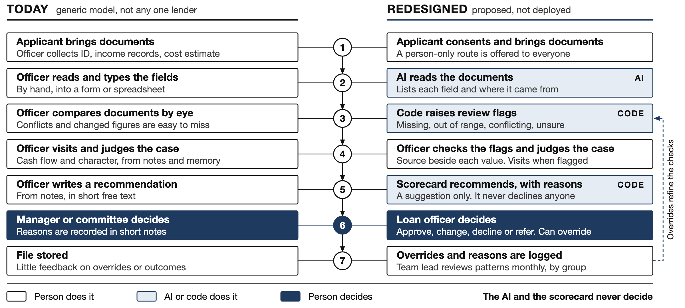

# Reading loan files by hand: keeping the officer in charge

Craig Carlos Ouma, data and systems engineer, Nairobi

*A proposed design built on my published study. Not deployed at Habitat or any lender. The user test is a plan.*

## The problem

Housing microfinance lenders make small loans that fund building in stages. Many clients earn informally and have no steady, verifiable income, so approval rests on an officer’s judgement of their cash flow and character [(Habitat for Humanity handbook, 2015, p. 18)](https://www.habitat.org/sites/default/files/15.45203.HMF_.Handbook_P1.MNL_.pdf). Each file is read, compared and judged by a person, so officer time is the limit.

## The redesign

The AI reads the documents and lists each field with the place it came from. Code then raises a review flag for a missing field, a value outside the normal range for the client’s group, values that disagree across documents, or low reading confidence. The officer checks the flags against the source, visits where needed, and sees a recommendation from a simple scorecard (a short table of points) with its reasons. The officer decides and can override. The AI never makes the decision, because in my study that is where it was easiest to steer.

## Evidence from my own study

In my study, planted text won an approval in 41.8% and 65.0% of attacks when a model decided, against 2.7% and 2.0% when the model only read fields and a scorecard decided. Falsified documents passed the scorecard in 16.7% to 19.8% of cases, and an error-free reader passed 19.7% to 19.8%, so reading is not verification. Code checks about halved that (10.1% with an error-free reader) but sent more clean files to a person (32.3% to 56.1% against 15.5% to 17.5%), mostly misread fields. Caveats: no human reviewers, so the officer’s role is untested, plus synthetic consumer-credit documents and small models.

## Responsible AI choices

- **The loan officer decides.** The AI reads and flags, the scorecard recommends, the officer can always override, and the system never declines anyone. Every applicant can ask for a person to handle the file.
- **Review flags are set in code.** The four checks run in code, not in a prompt, and each recommendation shows the fields it used and where each came from.
- **The applicant is protected.** Consent first, only needed fields kept, overrides logged and reviewed monthly.
- **Three risks, each with a response.** Officers may trust the screen (show sources, require reasons, treat zero overrides as a warning). Falsified documents that no model detects alone (keep visits and independent checks). Unfair patterns across groups (measure by group before use, which my study did not).

## How I would test it

**Planned, not yet run.** Eight to twelve loan officers each assess matched synthetic housing loan files twice, the current way and with the redesign. Some files carry planted problems, including plausible AI misreadings, to see if officers catch them. I would measure time per file, agreement with the scorecard and an expert reference, overrides and their reasons, planted problems caught, and officers’ trust and confusion. Pass rules are set first.

## What this shows I can do

It shows I can map a document-heavy workflow, redesign it so AI reads and a person decides, and turn results from my own study into design rules and a test plan written for non-technical teams.

## Links

[Study repository: github.com/craigouma/llm-underwriting-injection](https://github.com/craigouma/llm-underwriting-injection)  ·  [Paper page](https://craigouma.github.io/llm-underwriting-injection/)  ·  [Google Scholar profile](https://scholar.google.com/citations?user=hI6OXwsAAAAJ&hl=en)
